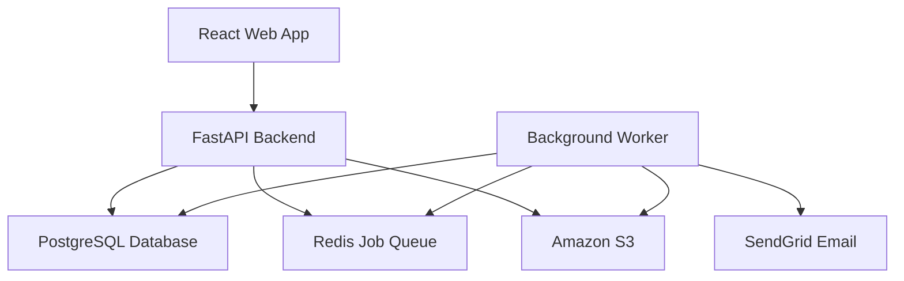
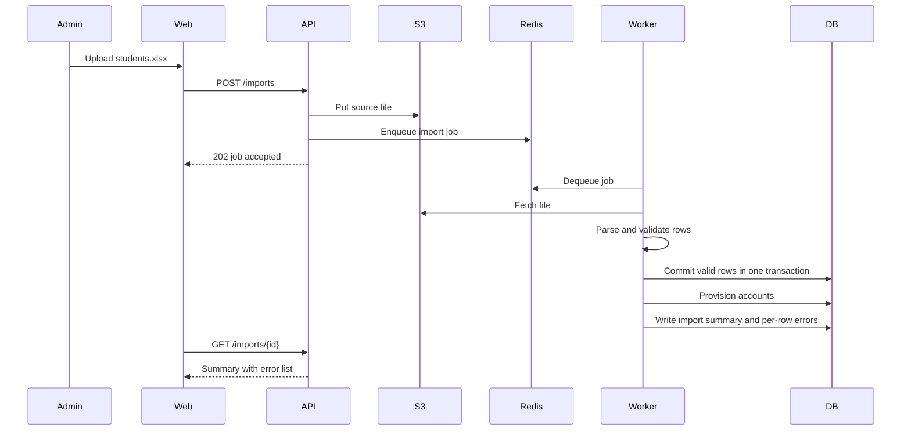
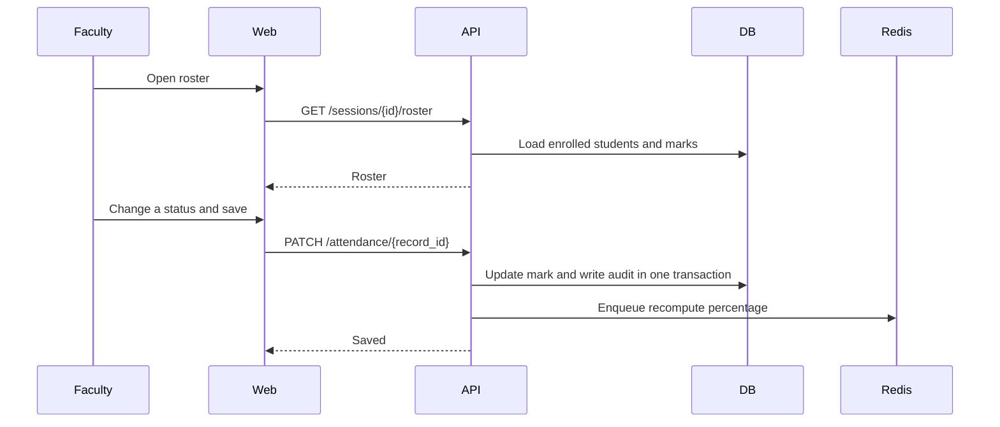
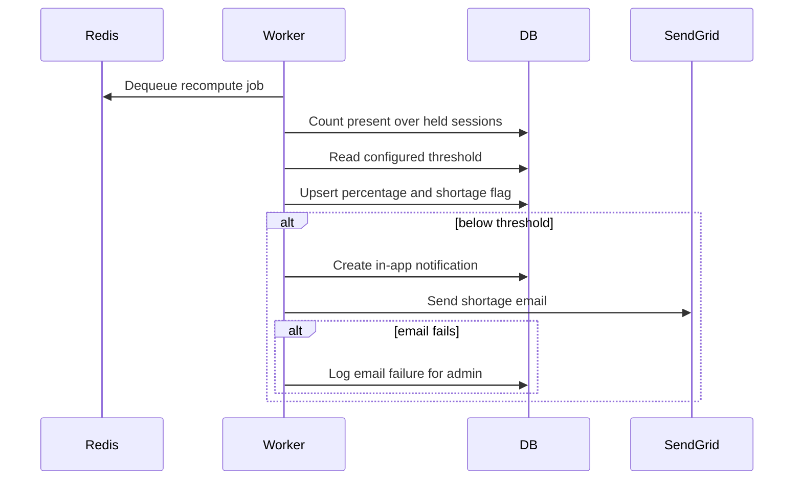
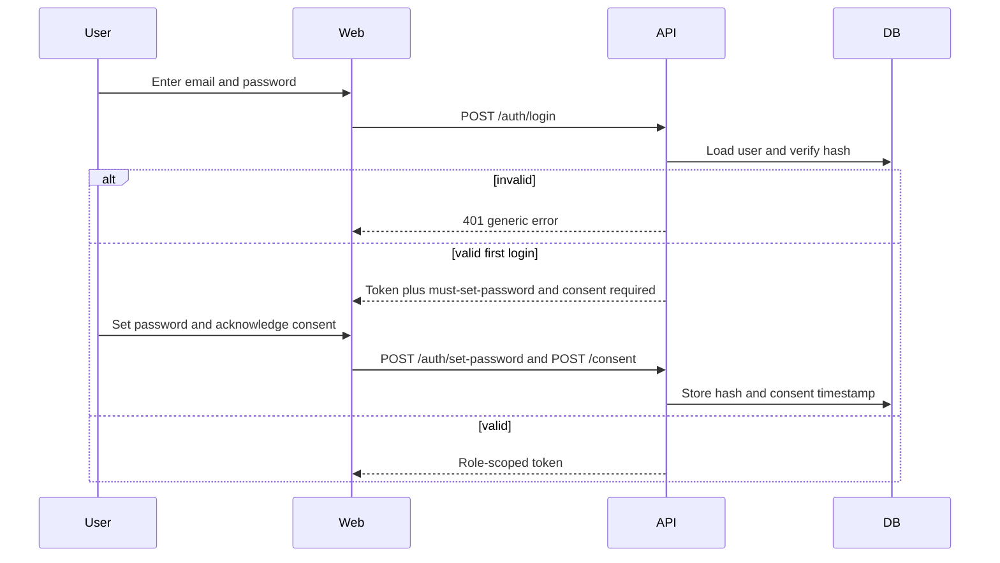
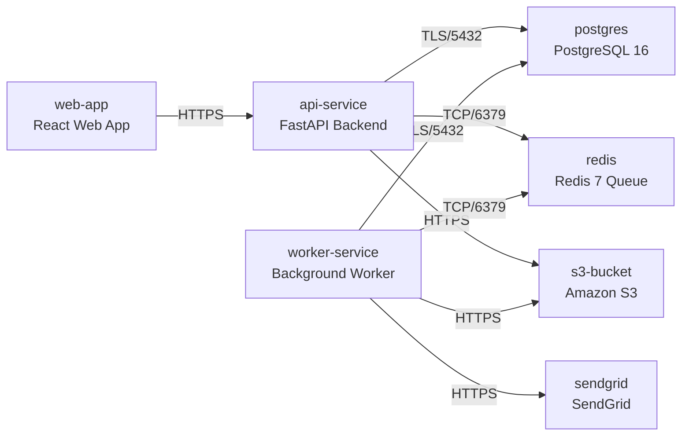

# Architecture

> Maintained by QuorQ AI SDLC. Text between `sdlc:auto` markers is regenerated; anything outside them is yours and is kept.

<!-- sdlc:auto:start narrative -->
## Overview

### ARCH-OVERVIEW · approved · source: architecture:v1

Approved v1 architecture: a React/FastAPI/PostgreSQL system on AWS Mumbai, with Redis as a background job queue, S3 for files, and SendGrid for email.

Components: web (React 19 SPA - login, roster marking, dashboards, student views, report filters, admin config, WCAG 2.1 AA/RPwD, no third-party tracking); api (FastAPI 0.115 - REST API, auth/RBAC, import validation, marking/correction with audit, computation, threshold config, report requests, consent records); worker (FastAPI 0.115 background jobs - spreadsheet parsing, account provisioning, percentage recompute, Excel/PDF report build, batched shortage emails); db (PostgreSQL 16 - system of record, transactional correction+audit writes, hosted in India); queue (Redis 7 - job queue for import/computation/report/email); object_store (Amazon S3, ap-south-1 - uploaded rosters and generated reports); email (SendGrid - transactional alerts and reset links, failures logged).
Technology decisions: Frontend React 19 (vs Vue/Angular) for accessible, keyboard-navigable component libraries; Backend FastAPI 0.115 (vs Django REST Framework/Flask) for pandas/openpyxl import/export and Redis-driven background work; Database PostgreSQL 16 (vs MySQL/SQLite) for relational modeling, SQL aggregation and ACID transactions; Cloud AWS (vs Azure/GCP) for full ap-south-1 (Mumbai) region residency and CERT-In log retention.
Deployment nodes: web-app (static build via CDN/container), api-service (Python 3.12/uvicorn), worker-service (Python 3.12 rq worker), postgres (RDS PostgreSQL, ap-south-1), redis (redis:7-alpine), s3-bucket (S3, ap-south-1), sendgrid (external SaaS).
Entities: users, students, courses, course_assignments, enrollments, class_sessions, attendance_records, attendance_audit, attendance_summary, app_config, import_jobs, notifications, ict_audit_log.
Endpoints (19): POST /auth/login; POST /auth/password-reset/request; POST /auth/set-password; POST /consent; DELETE /consent; POST /imports; GET /imports/{id}; POST /students; POST /courses; POST /timetable; GET /sessions/{id}/roster; PUT /sessions/{id}/roster; PATCH /attendance/{record_id}; GET /attendance/me; GET /dashboard/faculty; GET /config/threshold; PUT /config/threshold; POST /reports; GET /reports/{id}/download; GET /notifications; GET /audit/attendance.

**Related:** EPIC-001, EPIC-002, EPIC-003, EPIC-004, EPIC-005, EPIC-006, EPIC-007, EPIC-008

- ⚠ Data-residency claim depends on AWS ap-south-1 for compute/storage, but RDS backup snapshots, CloudWatch/observability logs and any CDN edge caching are not explicitly confirmed to remain within India.

### ARCH-CP-AUTH · approved · source: architecture:critical_path:Email/password login with RBAC

Login flow: credential verification, generic error on failure, role-scoped JWT, forced password set and DPDP consent for first-time users.

User logs in; credentials are verified; a generic error hides which field was wrong; a role-scoped JWT is issued; first-time users are prompted to set a password and acknowledge the DPDP consent notice before access. Endpoints: POST /auth/login, POST /auth/password-reset/request, POST /auth/set-password, POST /consent, DELETE /consent.

**Related:** US-001, US-002, US-003, US-004

- ⚠ JWT expiry/refresh strategy is not specified in the architecture input.

### ARCH-CP-IMPORT · approved · source: architecture:critical_path:Term spreadsheet import

Term spreadsheet import flow: S3 storage, background row validation, reference checks, account provisioning on success.

Admin uploads an Excel/CSV of students, courses or timetables; the file is stored in S3; a background job validates every row, flags unresolved references, and either rejects or reports per-row errors with no partial corruption; successful student/faculty rows provision accounts. Entity: import_jobs. Endpoints: POST /imports, GET /imports/{id}.

**Related:** US-005, US-006

### ARCH-CP-MARKING · approved · source: architecture:critical_path:Mark and correct attendance with audit

Roster marking and correction flow with same-transaction immutable audit write and recompute trigger.

Faculty opens a roster for an assigned session, marks present/absent and saves. Corrections to a saved record write an immutable audit entry (actor, old/new, timestamp) in the same transaction and enqueue percentage recomputation. Entities: attendance_records, attendance_audit. Endpoints: GET/PUT /sessions/{id}/roster, PATCH /attendance/{record_id}.

**Related:** US-007, US-008

### ARCH-CP-COMPUTE · approved · source: architecture:critical_path:Compute percentage and shortage alert

Background computation of present/held percentage, threshold comparison, in-app flag, and SendGrid email alert with failure handling.

A background job recomputes present/held percentage per student per course, compares against the configured threshold (default 75%), sets the in-app flag, and sends an email alert via SendGrid; email failure is logged while the in-app flag still shows. Entities: attendance_summary, notifications. Related endpoints: GET /attendance/me, GET /dashboard/faculty, GET /notifications.

**Related:** US-009, US-010, US-011, US-014
<!-- sdlc:auto:end narrative -->

<!-- sdlc:auto:start building-blocks -->
## Building Block View

| ID | Name | Technology | Responsibility | Depends on |
|---|---|---|---|---|
| web | React Web App | React 19 | Responsive, WCAG 2.1 AA / RPwD-compliant SPA for login, roster marking, dashboards, student attendance views, report filters and admin configuration, usable on phones and low-bandwidth connections with no third-party tracking. | api |
| api | FastAPI Backend | FastAPI 0.115 | Serves REST API, enforces email/password auth and role-based access, handles imports validation, attendance marking/correction with audit, percentage computation, threshold config, report generation requests and consent records. | db, queue, object_store |
| worker | Background Worker | FastAPI 0.115 | Runs heavy jobs off the web request: parse term spreadsheets, provision accounts, recompute attendance percentages, build Excel/PDF reports, and send batched shortage emails. | db, queue, object_store, email |
| db | PostgreSQL Database | PostgreSQL 16 | System of record for users, students, courses, timetables, sessions, attendance, enrollments, consent records, configuration and immutable audit/ICT logs, with transactional correction+audit writes, hosted in India. | — |
| queue | Redis Job Queue | Redis 7 | Holds background job tasks for import, computation, report build and email batches so the UI is never blocked. | — |
| object_store | Amazon S3 | Amazon S3 | Durable storage in AWS Mumbai for uploaded Excel/CSV rosters and generated Excel/PDF report files, keeping them off the database and server disk and inside India. | — |
| email | SendGrid Email | SendGrid | Transactional sender for shortage alerts and password-reset links with delivery tracking; failures are logged so the in-app flag still shows. | — |

<!-- sdlc:auto:end building-blocks -->

<!-- sdlc:auto:start runtime -->
## Runtime View

### Term spreadsheet import

Admin uploads an Excel/CSV of students, courses or timetables. File is stored in S3, a background job validates every row, flags unresolved references, and either rejects or reports per-row errors with no partial corruption; successful student/faculty rows provision accounts.

- **Components:** web, api, worker, object_store, db, queue
- **Modules:** imports.router, imports.service, imports.validators, accounts.provisioning, jobs.queue
- **Key functions:** upload_import(file, type), enqueue_import_job(file_key, type), validate_rows(df, schema), resolve_references(rows), provision_accounts(student_rows, faculty_rows), commit_or_rollback(valid_rows)

### Mark and correct attendance with audit

Faculty opens a roster for an assigned session, marks present/absent and saves. Corrections to a saved record write an immutable audit entry (actor, old/new, timestamp) in the same transaction and enqueue percentage recomputation.

- **Components:** web, api, db, queue
- **Modules:** attendance.router, attendance.service, audit.service, authz.roles
- **Key functions:** get_roster(session_id, faculty_id), save_roster(session_id, marks), update_mark(record_id, new_status, actor), write_audit(record_id, old, new, actor), enqueue_recompute(course_id, student_id)

### Compute percentage and shortage alert

A background job recomputes present/held percentage per student per course, compares against the configured threshold (default 75%), sets the in-app flag, and sends an email alert via SendGrid; email failure is logged while the in-app flag still shows.

- **Components:** worker, db, queue, email
- **Modules:** attendance.compute, config.threshold, notifications.service, email.sendgrid
- **Key functions:** compute_percentage(student_id, course_id), get_threshold(), evaluate_shortage(pct, threshold), create_in_app_flag(student_id, course_id), send_shortage_email(student, course)

### Email/password login with RBAC

User logs in; credentials are verified, a generic error hides which field was wrong, a role-scoped JWT is issued, first-time users are prompted to set a password and acknowledge the DPDP consent notice before access.

- **Components:** web, api, db, email
- **Modules:** auth.router, auth.service, auth.jwt, consent.service, authz.roles
- **Key functions:** login(email, password), verify_password(hash, raw), issue_token(user, role), request_reset(email), set_password(token, new_password), record_consent(user_id), withdraw_consent(user_id)

<!-- sdlc:auto:end runtime -->

<!-- sdlc:auto:start deployment-view -->
## Deployment View

| Name | Service | Runtime | Scaling | Environment |
|---|---|---|---|---|
| web-app | React Web App | Node static build served via CDN/container | static, CDN-cached | dev |
| api-service | FastAPI Backend | Python 3.12 / uvicorn container | 1-2 instances | dev |
| worker-service | Background Worker | Python 3.12 container (rq worker) | 1-2 instances, scale for term-start/exam peaks | dev |
| postgres | PostgreSQL 16 | RDS PostgreSQL (ap-south-1 Mumbai) | single instance, encrypted at rest | dev |
| redis | Redis 7 Queue | redis:7-alpine container | single instance | dev |
| s3-bucket | Amazon S3 | S3 (ap-south-1 Mumbai) | managed, encrypted | dev |
| sendgrid | SendGrid | External SaaS API | managed | dev |

| Source | Target | Protocol |
|---|---|---|
| web-app | api-service | HTTPS |
| api-service | postgres | TLS/5432 |
| api-service | redis | TCP/6379 |
| api-service | s3-bucket | HTTPS |
| worker-service | postgres | TLS/5432 |
| worker-service | redis | TCP/6379 |
| worker-service | s3-bucket | HTTPS |
| worker-service | sendgrid | HTTPS |

<!-- sdlc:auto:end deployment-view -->

<!-- sdlc:auto:start decisions -->
## Architecture Decisions

| Layer | Choice | ADR |
|---|---|---|
| Frontend | React 19 | [ADR-0001](adr/frontend.md) |
| Backend | FastAPI 0.115 | [ADR-0002](adr/backend.md) |
| Database | PostgreSQL 16 | [ADR-0003](adr/database.md) |
| Cloud | AWS | [ADR-0004](adr/cloud.md) |
<!-- sdlc:auto:end decisions -->

<!-- sdlc:auto:start links -->
## Related Documents

- [Data Model](data-model.md)
- [API Specification](api/openapi.yaml)
- [Architecture Decision Records](adr/README.md)
<!-- sdlc:auto:end links -->
