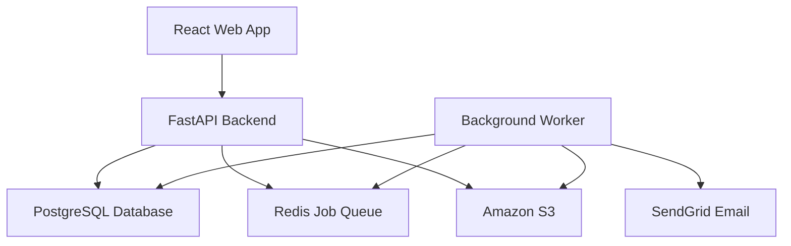
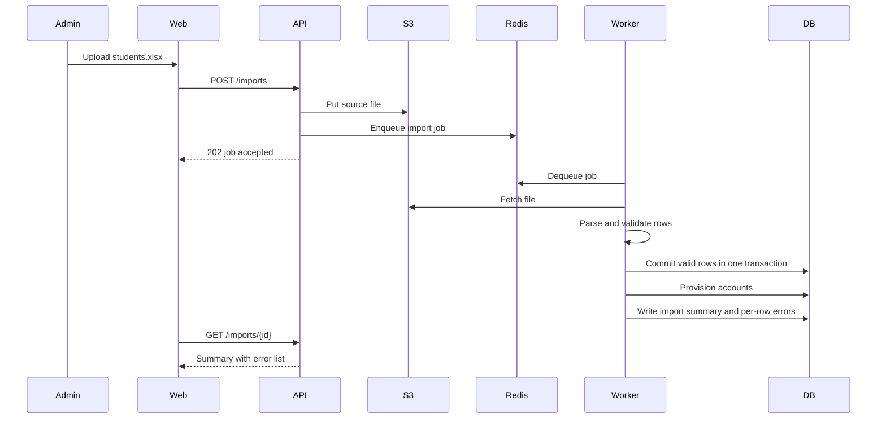
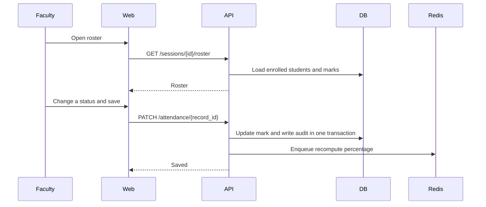
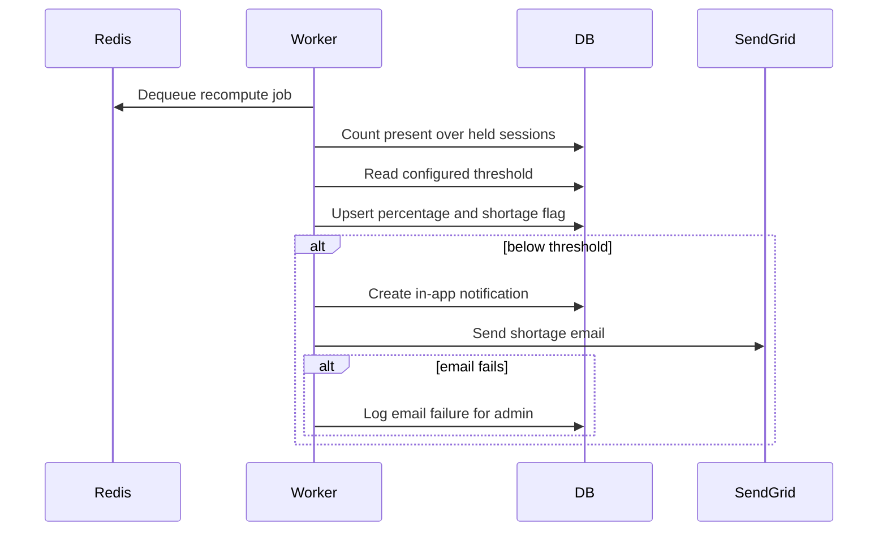
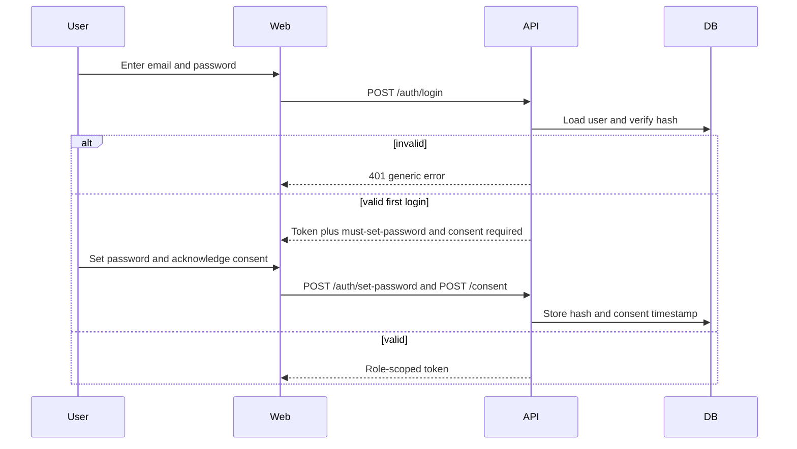
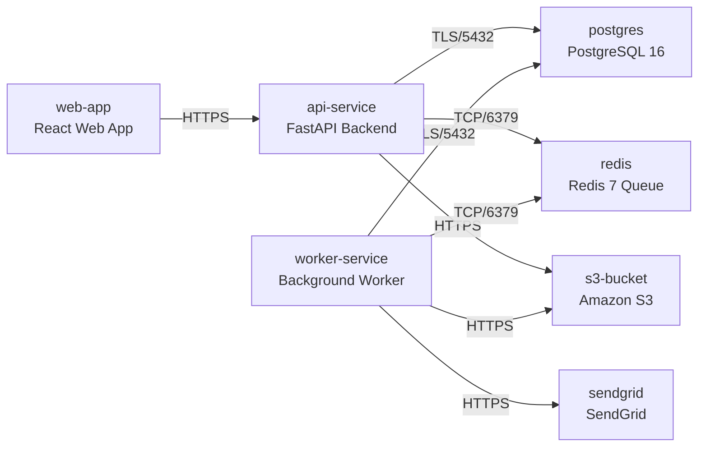

# Architecture

> Maintained by QuorQ AI SDLC. Text between `sdlc:auto` markers is regenerated; anything outside them is yours and is kept.

<!-- sdlc:auto:start narrative -->
## Overview

### ARCH-OVERVIEW · approved · source: architecture:summary

Approved v1 architecture for a browser-based attendance management system for a single Indian higher-education institution, serving faculty, students and admins/HODs.

System is a React 19 SPA over a FastAPI 0.115 backend with email/password RBAC auth, Excel/CSV roster provisioning, immutable-audit present/absent marking, per-student-per-course percentage computation, configurable 75% shortage threshold with alerts, and filtered Excel/PDF reporting. Heavy work (parsing, recomputation, report build, batch emails) is offloaded to a Redis-backed job queue processed by a Python worker. PostgreSQL 16 is the transactional store; S3 (Mumbai) holds uploads/generated files; SendGrid sends transactional email. All data, files and logs are pinned to AWS Indian regions for DPDP residency; ICT/audit logs retained 180 days per CERT-In. Frontend targets WCAG 2.1 AA / RPwD Act accessibility and low-bandwidth usability.

- ⚠ No explicit mapping given between this architecture and the specific US-001..US-020 requirement descriptions, so traceability to individual requirements could not be confirmed.
- ⚠ DPDP, CERT-In and RPwD Act are named as compliance drivers but no dedicated compliance/control checklist was supplied for this phase -- recommend a human confirm all applicable controls are covered.

### ARCH-COMP-WEB · approved · source: architecture:components:web

Web Frontend component: an accessible, responsive React 19 single-page app.

Handles login, consent, roster marking, dashboards, student attendance views, report filters and exports. Explicitly required to be accessible/responsive and to include no third-party trackers.

### ARCH-COMP-API · approved · source: architecture:components:api

API Backend component: FastAPI 0.115 REST service.

Provides auth/RBAC, consent records, imports, marking, computation, thresholds, dashboards and reports endpoints; writes audit/ICT logs and enqueues background jobs for heavy work.

### ARCH-COMP-WORKER · approved · source: architecture:components:worker

Background Worker component: FastAPI 0.115-based job consumer.

Consumes the Redis job queue to parse spreadsheets, provision accounts, recompute attendance percentages, build Excel/PDF reports, and send batch shortage emails -- keeping this work off the request path.

### ARCH-COMP-DB · approved · source: architecture:components:db

Relational Database component: PostgreSQL 16.

Transactional store for users, students, courses, timetables, sessions, attendance, consent, config and audit logs; also runs the aggregation queries that power reports.

### ARCH-COMP-QUEUE · approved · source: architecture:components:queue

Job Queue component: Redis 7.

Decouples heavy import/recompute/report/email jobs from the web request path, feeding the background worker.

### ARCH-COMP-STORAGE · approved · source: architecture:components:storage

Object Storage component: Amazon S3.

Durable storage, within India, of uploaded source spreadsheets and generated Excel/PDF reports.

### ARCH-COMP-EMAIL · approved · source: architecture:components:email

Transactional Email component: SendGrid.

Sends shortage-alert and password-reset emails with delivery tracking.

- ⚠ Delivery-tracking data is mentioned but no retention/visibility mechanism for tracking data is specified.

### ARCH-CP-LOGIN · approved · source: architecture:critical_paths:Login & Role-Based Access

Critical path for authentication, first-login consent, and per-request role enforcement.

User authenticates with email/password. First-time users must set a password and acknowledge the DPDP consent notice. Failed logins return a generic error (does not reveal which field was wrong). A JWT carries the user's role and is enforced on every request. Backed by endpoints POST /auth/login, POST /auth/password-reset/request, POST /auth/password-reset/confirm, GET /consent/status, POST /consent/acknowledge, POST /consent/withdraw.

### ARCH-CP-IMPORT · approved · source: architecture:critical_paths:Term Spreadsheet Import

Critical path for admin bulk-provisioning of students, courses and timetables via spreadsheet upload.

Admin uploads an Excel/CSV of students, courses or timetables. File is stored in S3; a background job parses and validates it, provisions accounts, reports per-row errors, and guarantees no partial corruption on failure. Backed by POST /imports and GET /imports/{id}, with import_jobs table tracking status, rows_imported and error_report.

### ARCH-CP-MARKING · approved · source: architecture:critical_paths:Session Marking & Audit Trail

Critical path for faculty marking attendance with a tamper-evident audit trail.

Faculty open a roster for an assigned session, mark present/absent and save. Corrections write an immutable audit entry (actor, old/new status, timestamp) in the same transaction as the update, and trigger recomputation of attendance percentages. Backed by GET/PUT /sessions/{id}/roster, PUT /attendance/{recordId}, GET /attendance/audit (read-only), and the attendance_records/attendance_audit tables.

### ARCH-CP-SHORTAGE · approved · source: architecture:critical_paths:Shortage Detection & Alerts

Critical path for detecting and alerting on low attendance after any marking or correction.

After marking or correction, the worker recomputes percentage per student per course, flags students below the configured threshold (default 75%), raises an in-app notification, and emails the student. If the email fails, the failure is logged but the in-app flag still shows. Backed by GET/PUT /config/threshold, GET /notifications, course_attendance_summary and notifications tables.

### ARCH-DATA-MODEL · approved · source: architecture:entities

Full relational schema covering identity, academic structure, attendance, audit, config, imports and notifications.

Entities: users (auth/role/password state), consent_records (DPDP acknowledgement/withdrawal history), students, courses, enrollments, course_faculty (assignment), sessions (per-course scheduled class), attendance_records (per-student mark with marked_by/marked_at), attendance_audit (immutable change history: old/new status, changed_by, changed_at), course_attendance_summary (precomputed sessions_present/total, percentage, below_threshold), app_config (key/value settings incl. threshold), import_jobs (upload tracking incl. error_report), notifications (in-app + email_status), and audit_log (general actor/action/entity trail).

### ARCH-API-ENDPOINTS · approved · source: architecture:endpoints

19 REST endpoints covering auth, consent, imports, student/course management, roster marking, attendance correction/audit, dashboards, config and reporting.

Auth: POST /auth/login (generic failure error), POST /auth/password-reset/request, POST /auth/password-reset/confirm (also used for first-login password set). Consent: GET /consent/status, POST /consent/acknowledge, POST /consent/withdraw. Imports: POST /imports, GET /imports/{id}. Records: POST /students and POST /courses (duplicate-prevention warnings). Marking: GET/PUT /sessions/{id}/roster, PUT /attendance/{recordId} (audited correction), GET /attendance/audit (read-only). Views: GET /me/attendance (student), GET /faculty/dashboard. Config: GET/PUT /config/threshold. Reporting: POST /reports (faculty scoped to assigned classes), GET /reports/{id}/export (Excel/PDF from S3). Notifications: GET /notifications.

### ARCH-DEPLOYMENT · approved · source: architecture:deployment_nodes

All seven deployment nodes are hosted in AWS ap-south-1 (Mumbai) for DPDP data residency.

Frontend: static React 19 build on S3 + CloudFront. API service: FastAPI 0.115 on Uvicorn/Python 3.12, ECS Fargate (ap-south-1). Worker service: Python 3.12 RQ worker, ECS Fargate (ap-south-1). Database: Amazon RDS for PostgreSQL 16 (ap-south-1). Queue: Redis 7 (container/ElastiCache, ap-south-1), redis:7-alpine. Object storage: S3 (ap-south-1 Mumbai) with SSE encryption. Email provider: SendGrid (SaaS API, outside the AWS India boundary).

- ⚠ SendGrid is a third-party SaaS outside the AWS India region boundary; its own data-residency/DPDP posture for email content is not addressed in this input.

### ARCH-TECH-FRONTEND · approved · source: architecture:technology_decisions:Frontend

React 19 approved over Angular and Vue for the frontend stack.

React 19 drives the roster-marking screen, dashboards, student views and report filters as a responsive SPA, paired with an accessible component library so core flows meet WCAG 2.1 AA / RPwD Act and remain usable on low-bandwidth mobile browsers.

### ARCH-TECH-BACKEND · approved · source: architecture:technology_decisions:Backend

FastAPI 0.115 approved over Django REST Framework and Flask for the backend stack.

FastAPI 0.115 sits directly on pandas/openpyxl for Excel/CSV import and computation and on reportlab for PDF export, and runs an RQ worker for background jobs, so imports, recomputation and reports use first-class Python libraries.

### ARCH-TECH-DB · approved · source: architecture:technology_decisions:Database

PostgreSQL 16 approved over MySQL and SQLite for the database.

Holds students, courses, timetables, sessions and marks; SQL aggregation computes per-student-per-course percentages for reports. Transactions commit a correction and its audit entry together, supporting tamper-evident history and DPDP consent records.

### ARCH-TECH-CLOUD · approved · source: architecture:technology_decisions:Cloud

AWS approved over Azure and GCP as the cloud provider.

AWS's full regions in Mumbai/Hyderabad let the database, S3 files and logs be pinned to Indian soil for DPDP residency, with CloudWatch retaining ICT/audit logs 180 days per CERT-In; capacity is judged ample for one institution's term-start and marking peaks.
<!-- sdlc:auto:end narrative -->

<!-- sdlc:auto:start building-blocks -->
## Building Block View

| ID | Name | Technology | Responsibility | Depends on |
|---|---|---|---|---|
| web | React Web App | React 19 | Responsive, WCAG 2.1 AA / RPwD-compliant SPA for login, roster marking, dashboards, student attendance views, report filters and admin configuration, usable on phones and low-bandwidth connections with no third-party tracking. | api |
| api | FastAPI Backend | FastAPI 0.115 | Serves REST API, enforces email/password auth and role-based access, handles imports validation, attendance marking/correction with audit, percentage computation, threshold config, report generation requests and consent records. | db, queue, object_store |
| worker | Background Worker | FastAPI 0.115 | Runs heavy jobs off the web request: parse term spreadsheets, provision accounts, recompute attendance percentages, build Excel/PDF reports, and send batched shortage emails. | db, queue, object_store, email |
| db | PostgreSQL Database | PostgreSQL 16 | System of record for users, students, courses, timetables, sessions, attendance, enrollments, consent records, configuration and immutable audit/ICT logs, with transactional correction+audit writes, hosted in India. | — |
| queue | Redis Job Queue | Redis 7 | Holds background job tasks for import, computation, report build and email batches so the UI is never blocked. | — |
| object_store | Amazon S3 | Amazon S3 | Durable storage in AWS Mumbai for uploaded Excel/CSV rosters and generated Excel/PDF report files, keeping them off the database and server disk and inside India. | — |
| email | SendGrid Email | SendGrid | Transactional sender for shortage alerts and password-reset links with delivery tracking; failures are logged so the in-app flag still shows. | — |

<!-- sdlc:auto:end building-blocks -->

<!-- sdlc:auto:start runtime -->
## Runtime View

### Term spreadsheet import

Admin uploads an Excel/CSV of students, courses or timetables. File is stored in S3, a background job validates every row, flags unresolved references, and either rejects or reports per-row errors with no partial corruption; successful student/faculty rows provision accounts.

- **Components:** web, api, worker, object_store, db, queue
- **Modules:** imports.router, imports.service, imports.validators, accounts.provisioning, jobs.queue
- **Key functions:** upload_import(file, type), enqueue_import_job(file_key, type), validate_rows(df, schema), resolve_references(rows), provision_accounts(student_rows, faculty_rows), commit_or_rollback(valid_rows)

### Mark and correct attendance with audit

Faculty opens a roster for an assigned session, marks present/absent and saves. Corrections to a saved record write an immutable audit entry (actor, old/new, timestamp) in the same transaction and enqueue percentage recomputation.

- **Components:** web, api, db, queue
- **Modules:** attendance.router, attendance.service, audit.service, authz.roles
- **Key functions:** get_roster(session_id, faculty_id), save_roster(session_id, marks), update_mark(record_id, new_status, actor), write_audit(record_id, old, new, actor), enqueue_recompute(course_id, student_id)

### Compute percentage and shortage alert

A background job recomputes present/held percentage per student per course, compares against the configured threshold (default 75%), sets the in-app flag, and sends an email alert via SendGrid; email failure is logged while the in-app flag still shows.

- **Components:** worker, db, queue, email
- **Modules:** attendance.compute, config.threshold, notifications.service, email.sendgrid
- **Key functions:** compute_percentage(student_id, course_id), get_threshold(), evaluate_shortage(pct, threshold), create_in_app_flag(student_id, course_id), send_shortage_email(student, course)

### Email/password login with RBAC

User logs in; credentials are verified, a generic error hides which field was wrong, a role-scoped JWT is issued, first-time users are prompted to set a password and acknowledge the DPDP consent notice before access.

- **Components:** web, api, db, email
- **Modules:** auth.router, auth.service, auth.jwt, consent.service, authz.roles
- **Key functions:** login(email, password), verify_password(hash, raw), issue_token(user, role), request_reset(email), set_password(token, new_password), record_consent(user_id), withdraw_consent(user_id)

<!-- sdlc:auto:end runtime -->

<!-- sdlc:auto:start deployment-view -->
## Deployment View

| Name | Service | Runtime | Scaling | Environment |
|---|---|---|---|---|
| web-app | React Web App | Node static build served via CDN/container | static, CDN-cached | dev |
| api-service | FastAPI Backend | Python 3.12 / uvicorn container | 1-2 instances | dev |
| worker-service | Background Worker | Python 3.12 container (rq worker) | 1-2 instances, scale for term-start/exam peaks | dev |
| postgres | PostgreSQL 16 | RDS PostgreSQL (ap-south-1 Mumbai) | single instance, encrypted at rest | dev |
| redis | Redis 7 Queue | redis:7-alpine container | single instance | dev |
| s3-bucket | Amazon S3 | S3 (ap-south-1 Mumbai) | managed, encrypted | dev |
| sendgrid | SendGrid | External SaaS API | managed | dev |

| Source | Target | Protocol |
|---|---|---|
| web-app | api-service | HTTPS |
| api-service | postgres | TLS/5432 |
| api-service | redis | TCP/6379 |
| api-service | s3-bucket | HTTPS |
| worker-service | postgres | TLS/5432 |
| worker-service | redis | TCP/6379 |
| worker-service | s3-bucket | HTTPS |
| worker-service | sendgrid | HTTPS |

<!-- sdlc:auto:end deployment-view -->

<!-- sdlc:auto:start decisions -->
## Architecture Decisions

| Layer | Choice | ADR |
|---|---|---|
| Frontend | React 19 | [ADR-0001](adr/frontend.md) |
| Backend | FastAPI 0.115 | [ADR-0002](adr/backend.md) |
| Database | PostgreSQL 16 | [ADR-0003](adr/database.md) |
| Cloud | AWS | [ADR-0004](adr/cloud.md) |
<!-- sdlc:auto:end decisions -->

<!-- sdlc:auto:start links -->
## Related Documents

- [Data Model](data-model.md)
- [API Specification](api/openapi.yaml)
- [Architecture Decision Records](adr/README.md)
<!-- sdlc:auto:end links -->
