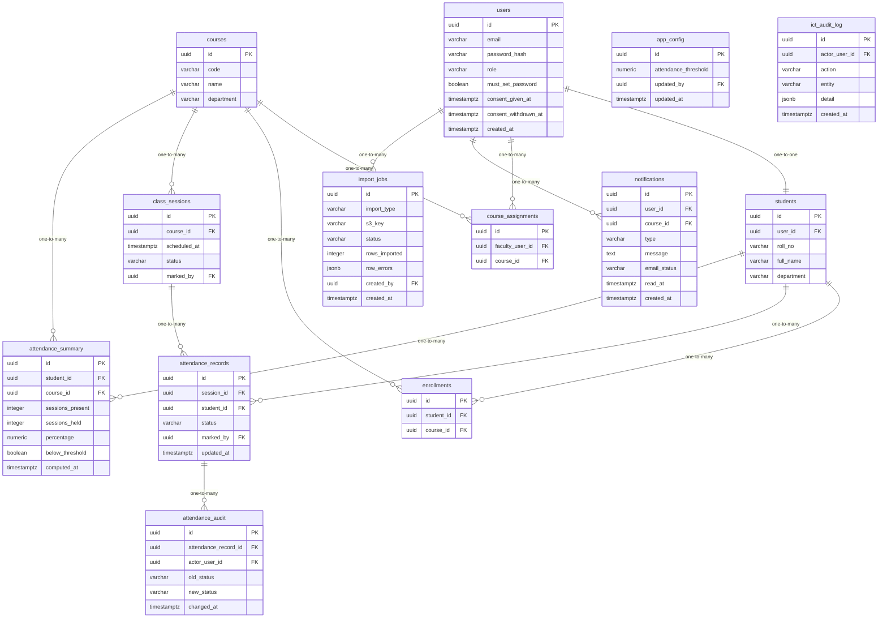

# Data Model

<!-- sdlc:auto:start entities -->
### users

| Field | Type | PK | FK | Nullable |
|---|---|---|---|---|
| id | uuid | True | — | False |
| email | varchar | False | — | False |
| password_hash | varchar | False | — | True |
| role | varchar | False | — | False |
| must_set_password | boolean | False | — | False |
| consent_given_at | timestamptz | False | — | True |
| consent_withdrawn_at | timestamptz | False | — | True |
| created_at | timestamptz | False | — | False |

### students

| Field | Type | PK | FK | Nullable |
|---|---|---|---|---|
| id | uuid | True | — | False |
| user_id | uuid | False | users.id | False |
| roll_no | varchar | False | — | False |
| full_name | varchar | False | — | False |
| department | varchar | False | — | True |

### courses

| Field | Type | PK | FK | Nullable |
|---|---|---|---|---|
| id | uuid | True | — | False |
| code | varchar | False | — | False |
| name | varchar | False | — | False |
| department | varchar | False | — | True |

### course_assignments

| Field | Type | PK | FK | Nullable |
|---|---|---|---|---|
| id | uuid | True | — | False |
| faculty_user_id | uuid | False | users.id | False |
| course_id | uuid | False | courses.id | False |

### enrollments

| Field | Type | PK | FK | Nullable |
|---|---|---|---|---|
| id | uuid | True | — | False |
| student_id | uuid | False | students.id | False |
| course_id | uuid | False | courses.id | False |

### class_sessions

| Field | Type | PK | FK | Nullable |
|---|---|---|---|---|
| id | uuid | True | — | False |
| course_id | uuid | False | courses.id | False |
| scheduled_at | timestamptz | False | — | False |
| status | varchar | False | — | False |
| marked_by | uuid | False | users.id | True |

### attendance_records

| Field | Type | PK | FK | Nullable |
|---|---|---|---|---|
| id | uuid | True | — | False |
| session_id | uuid | False | class_sessions.id | False |
| student_id | uuid | False | students.id | False |
| status | varchar | False | — | False |
| marked_by | uuid | False | users.id | False |
| updated_at | timestamptz | False | — | False |

### attendance_audit

| Field | Type | PK | FK | Nullable |
|---|---|---|---|---|
| id | uuid | True | — | False |
| attendance_record_id | uuid | False | attendance_records.id | False |
| actor_user_id | uuid | False | users.id | False |
| old_status | varchar | False | — | True |
| new_status | varchar | False | — | False |
| changed_at | timestamptz | False | — | False |

### attendance_summary

| Field | Type | PK | FK | Nullable |
|---|---|---|---|---|
| id | uuid | True | — | False |
| student_id | uuid | False | students.id | False |
| course_id | uuid | False | courses.id | False |
| sessions_present | integer | False | — | False |
| sessions_held | integer | False | — | False |
| percentage | numeric | False | — | False |
| below_threshold | boolean | False | — | False |
| computed_at | timestamptz | False | — | False |

### app_config

| Field | Type | PK | FK | Nullable |
|---|---|---|---|---|
| id | uuid | True | — | False |
| attendance_threshold | numeric | False | — | False |
| updated_by | uuid | False | users.id | True |
| updated_at | timestamptz | False | — | False |

### import_jobs

| Field | Type | PK | FK | Nullable |
|---|---|---|---|---|
| id | uuid | True | — | False |
| import_type | varchar | False | — | False |
| s3_key | varchar | False | — | False |
| status | varchar | False | — | False |
| rows_imported | integer | False | — | True |
| row_errors | jsonb | False | — | True |
| created_by | uuid | False | users.id | False |
| created_at | timestamptz | False | — | False |

### notifications

| Field | Type | PK | FK | Nullable |
|---|---|---|---|---|
| id | uuid | True | — | False |
| user_id | uuid | False | users.id | False |
| course_id | uuid | False | courses.id | True |
| type | varchar | False | — | False |
| message | text | False | — | False |
| email_status | varchar | False | — | True |
| read_at | timestamptz | False | — | True |
| created_at | timestamptz | False | — | False |

### ict_audit_log

| Field | Type | PK | FK | Nullable |
|---|---|---|---|---|
| id | uuid | True | — | False |
| actor_user_id | uuid | False | users.id | True |
| action | varchar | False | — | False |
| entity | varchar | False | — | True |
| detail | jsonb | False | — | True |
| created_at | timestamptz | False | — | False |
<!-- sdlc:auto:end entities -->

<!-- sdlc:auto:start relationships -->
| Source | Target | Type |
|---|---|---|
| users | students | one-to-one |
| users | course_assignments | one-to-many |
| courses | course_assignments | one-to-many |
| students | enrollments | one-to-many |
| courses | enrollments | one-to-many |
| courses | class_sessions | one-to-many |
| class_sessions | attendance_records | one-to-many |
| students | attendance_records | one-to-many |
| attendance_records | attendance_audit | one-to-many |
| students | attendance_summary | one-to-many |
| courses | attendance_summary | one-to-many |
| users | notifications | one-to-many |
| users | import_jobs | one-to-many |
<!-- sdlc:auto:end relationships -->

<!-- sdlc:auto:start er-diagram -->

<!-- sdlc:auto:end er-diagram -->
