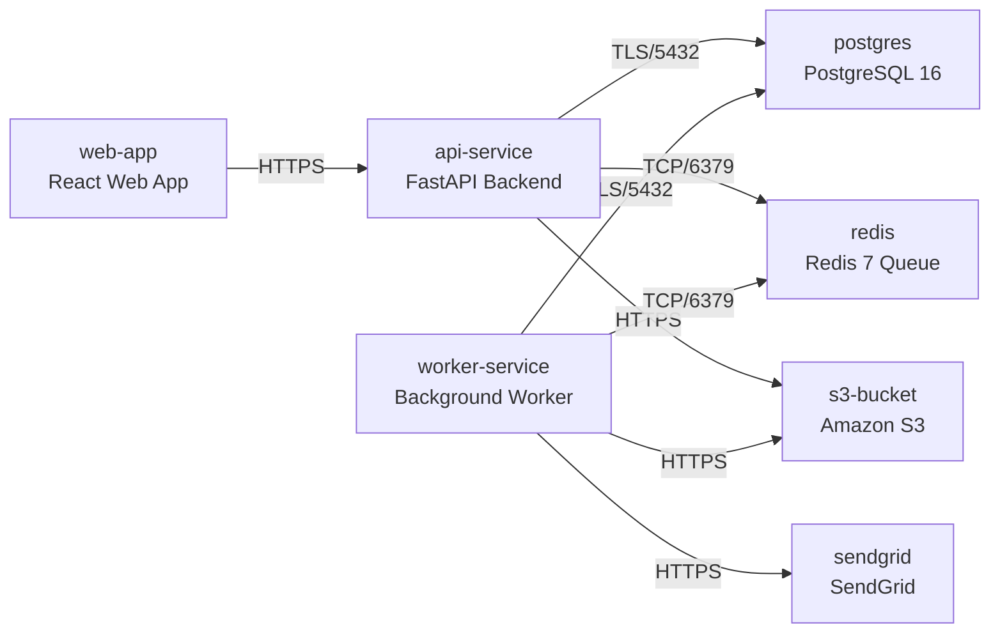

# Deployment Guide

> Maintained by QuorQ AI SDLC. Text between `sdlc:auto` markers is regenerated; anything outside them is yours and is kept.

<!-- sdlc:auto:start how-it-deploys -->
Pushes to `main` run `.github/workflows/deploy.yml`, which builds the API image (if there is a backend) and deploys the SPA to AWS Amplify. Commits touching only `docs/sdlc/**` don't deploy. Deployments can also be started from the platform's Deployment tab.
<!-- sdlc:auto:end how-it-deploys -->

<!-- sdlc:auto:start environments -->
| Name | Service | Runtime | Scaling | Environment |
|---|---|---|---|---|
| web-app | React Web App | Node static build served via CDN/container | static, CDN-cached | dev |
| api-service | FastAPI Backend | Python 3.12 / uvicorn container | 1-2 instances | dev |
| worker-service | Background Worker | Python 3.12 container (rq worker) | 1-2 instances, scale for term-start/exam peaks | dev |
| postgres | PostgreSQL 16 | RDS PostgreSQL (ap-south-1 Mumbai) | single instance, encrypted at rest | dev |
| redis | Redis 7 Queue | redis:7-alpine container | single instance | dev |
| s3-bucket | Amazon S3 | S3 (ap-south-1 Mumbai) | managed, encrypted | dev |
| sendgrid | SendGrid | External SaaS API | managed | dev |
<!-- sdlc:auto:end environments -->

<!-- sdlc:auto:start live -->
**Frontend URL:** https://p3a35e3fd0ddc.dshared.amplifyapp.local

**Backend URL:** https://3a35e3fd0ddc.local.awsapprunner.local

**Database:** PostgreSQL · aisdlc_3a35e3fd0ddc

**Version:** e3c214bcec68

**Commit:** `e3c214b`

**Finished:** 2026-10-29
<!-- sdlc:auto:end live -->

<!-- sdlc:auto:start topology -->

<!-- sdlc:auto:end topology -->
